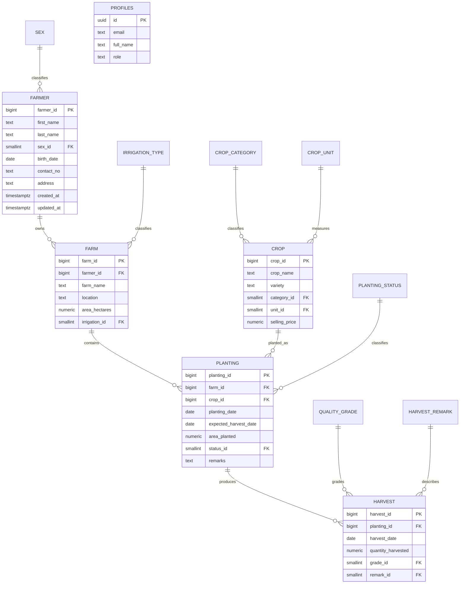

# Agriculture Information System — Project Documentation

**Cebu Technological University**
**AP3 — Midterm Project**
**Project title:** AgriSys — Web-Based Agriculture Information System
**Database:** Supabase PostgreSQL
**Application:** Responsive web application (HTML, CSS, JavaScript, Bootstrap 5)

---

## 1. Project description

AgriSys is a working agriculture information system for recording and monitoring smallholder farm
activity. It stores farmer profiles, farm lots, crop master data, planting transactions and harvest
transactions in a normalized Supabase PostgreSQL database, and provides a secure web interface for
day-to-day data entry, monitoring and reporting.

The system demonstrates:

- relational database design normalized to Third Normal Form (3NF);
- primary key, foreign key, unique and check constraints;
- controlled dropdown values backed by lookup tables;
- full Create, Read, Update and Delete operations;
- server-side search, filtering, sorting and pagination;
- JOINed views for related information;
- user authentication with Administrator and Staff roles;
- a live dashboard, six reports, printing and CSV export;
- input validation, audit timestamps, delete confirmation and referential integrity.

---

## 2. Objectives

1. Design a normalized relational database for agricultural records from UNF through 3NF.
2. Implement the database in Supabase PostgreSQL with complete keys, constraints and relationships.
3. Develop a working web system with CRUD operations for farmers, farms, crops, plantings and harvests.
4. Display related records through JOIN operations (for example, a planting with its farm, farmer and crop).
5. Provide a dashboard whose values are calculated from live database data.
6. Secure the system with authentication, role-based access control and Row Level Security.
7. Validate user input in the application and enforce business rules in the database.
8. Provide search, filters, sorting, pagination, reports and export for decision-making.
9. Deliver complete documentation, an ERD, a data dictionary and test evidence.

---

## 3. Scope and users

| User | Description | Main activities |
| --- | --- | --- |
| Administrator | System owner or agricultural office staff | All CRUD operations, deletion, user role management, reports |
| Staff | Encoder / field staff | View records, add and update farmers, farms, crops, plantings and harvests, generate reports |

Authentication is handled by Supabase Auth. Public sign-up is disabled; accounts are provisioned by
the administrator.

---

## 4. Functional requirements

| ID | Requirement | Implementation |
| --- | --- | --- |
| FR-01 | Farmer management | `farmers.html`, `farmer` table, `v_farmer` view |
| FR-02 | Farm management linked to a farmer | `farms.html`, `farm.farmer_id` FK |
| FR-03 | Crop master data with category, unit and price | `crops.html`, `crop` table |
| FR-04 | Planting transactions linked to farm and crop | `plantings.html`, `planting` table |
| FR-05 | Harvest transactions linked to a planting | `harvests.html`, `harvest` table |
| FR-06 | Controlled dropdown values stored as IDs | Seven lookup tables + `<select>` controls |
| FR-07 | Dashboard after login | `dashboard.html` |
| FR-08 | Summary cards for all five modules | Five KPI cards, dynamic counts |
| FR-09 | Recent plantings and harvests | `dashboard.html` recent tables |
| FR-10 | Plantings by status | Doughnut chart from `v_planting_status_summary` |
| FR-11 | Total harvested quantity and value | Harvest-at-a-glance panel, `v_harvest` |
| FR-12 | Login and protected pages | `js/auth.js`, Supabase Auth |
| FR-13 | Two roles with restricted functions | `profiles.role`, RLS, UI guards |
| FR-14 | Search, filter, sort and pagination | `js/crud.js`, server-side queries |
| FR-15 | Six required reports with date range | `reports.html`, `js/pages/reports.js` |
| FR-16 | Data tables with view/edit/delete actions | Reusable CRUD engine |
| FR-17 | Delete confirmation and FK-safe deletion | Confirmation modal, `ON DELETE RESTRICT` |
| FR-18 | Success and error messages | Toasts and inline form alerts |
| FR-19 | Audit information | `created_at`, `updated_at` + trigger |
| FR-20 | Responsive interface | Bootstrap grid + custom media queries |
| FR-21 | Print and CSV export | Print stylesheet, Blob download |
| FR-22 | Database constraints and referential integrity | PK, FK, UNIQUE, NOT NULL, CHECK, triggers |

---

## 5. System architecture

```
┌──────────────────────────────────────────────────────────────┐
│  Browser                                                     │
│  HTML pages + Bootstrap 5 + vanilla JS + Chart.js            │
│  ├── js/auth.js      session guard and role check             │
│  ├── js/crud.js      reusable CRUD/search/sort/pagination     │
│  ├── js/api.js       Supabase queries, lookups, error mapping │
│  └── js/ui.js        formatting, toasts, modals, pagination   │
└───────────────────────────┬──────────────────────────────────┘
                            │ HTTPS (Supabase JS client, anon key)
                            ▼
┌──────────────────────────────────────────────────────────────┐
│  Supabase                                                    │
│  ├── Supabase Auth        email + password, JWT sessions      │
│  ├── PostgREST API        tables and read-only views          │
│  ├── Row Level Security   staff read/write, admin delete      │
│  └── PostgreSQL           tables, constraints, triggers,      │
│                           functions, views                    │
└──────────────────────────────────────────────────────────────┘
```

The front end contains no service-role credentials. All access is authorized per request by the
user’s JWT and the RLS policies defined in `supabase/schema.sql`.

---

## 6. Entity-Relationship Diagram (ERD)



### Relationship summary

| Relationship | Cardinality | Foreign key | Delete rule |
| --- | --- | --- | --- |
| FARMER → FARM | 1 : M | `farm.farmer_id` | RESTRICT |
| FARM → PLANTING | 1 : M | `planting.farm_id` | RESTRICT |
| CROP → PLANTING | 1 : M | `planting.crop_id` | RESTRICT |
| PLANTING → HARVEST | 1 : M | `harvest.planting_id` | RESTRICT |
| SEX → FARMER | 1 : M | `farmer.sex_id` | — |
| IRRIGATION_TYPE → FARM | 1 : M | `farm.irrigation_id` | — |
| CROP_CATEGORY → CROP | 1 : M | `crop.category_id` | — |
| CROP_UNIT → CROP | 1 : M | `crop.unit_id` | — |
| PLANTING_STATUS → PLANTING | 1 : M | `planting.status_id` | — |
| QUALITY_GRADE → HARVEST | 1 : M | `harvest.grade_id` | — |
| HARVEST_REMARK → HARVEST | 1 : M | `harvest.remark_id` | — |

The `ON DELETE RESTRICT` rules prevent deleting a parent record that still has children, protecting
referential integrity. The application catches the resulting error and explains it to the user.

---

## 7. Normalization process

### 7.1 Unnormalized form (UNF)

A single spreadsheet-style record would look like this:

| farmer_name | address | contact | farms | crops | plantings | harvests |
| --- | --- | --- | --- | --- | --- | --- |
| Juan Dela Cruz | Talamban, Cebu City | 09171234567 | Dela Cruz Rice Field (1.5 ha, Irrigated); Second Field (2 ha, Irrigated) | Rice (Cereal, kg, ₱22.50); Mongo (Legume, kg, ₱75.00) | Rice 2025-06-15 → Harvested; Rice 2026-06-20 → Harvested | 2025-10-12, 1800 kg, Grade A, Good Harvest; 2025-10-14, 650 kg, Grade B, Acceptable Quality |

Problems: repeating groups (several farms, crops, plantings, harvests in one row), non-atomic values,
duplicated descriptive text, and no stable identifier.

### 7.2 First Normal Form (1NF)

Rules applied: every cell contains one atomic value; each row has a primary key; repeating groups are
moved into their own tables.

Resulting relations:

- `FARMER(farmer_id, first_name, last_name, sex, birth_date, contact_no, address)`
- `FARM(farm_id, farm_name, location, area_hectares, irrigation, farmer_id)`
- `CROP(crop_id, crop_name, variety, category, unit, selling_price)`
- `PLANTING(planting_id, farm_id, crop_id, planting_date, expected_harvest_date, area_planted, status, remarks)`
- `HARVEST(harvest_id, planting_id, harvest_date, quantity_harvested, quality_grade, remark)`

A farmer with several farms now has one row per farm; a planting with several harvests has one row
per harvest.

### 7.3 Second Normal Form (2NF)

Rule applied: no non-key attribute may depend on only part of a composite key.

In a combined planting/harvest relation keyed by `(planting_id, harvest_id)`, attributes such as
farmer name, farmland area and crop price depend only on the planting or farm, not on the harvest.
These partial dependencies were removed by separating `PLANTING` and `HARVEST` and by keeping farm
and crop data in their own relations. Each resulting table uses a single-column primary key, so all
non-key attributes depend on the whole key.

### 7.4 Third Normal Form (3NF)

Rule applied: no transitive dependencies — non-key attributes must not depend on other non-key
attributes.

The 2NF relations still stored descriptive text such as `sex`, `irrigation`, `category`, `unit`,
`status`, `quality_grade` and `remark`. For example:

```
farmer_id → sex_id → sex_description        (transitive dependency)
```

Descriptions were moved into reference tables and the transaction tables now store only the numeric
code:

| Lookup table | Stored in | Example |
| --- | --- | --- |
| `sex` | `farmer.sex_id` | 1 = Male, 2 = Female |
| `irrigation_type` | `farm.irrigation_id` | 2 = Irrigated (NIA) |
| `crop_category` | `crop.category_id` | 1 = Cereal |
| `crop_unit` | `crop.unit_id` | 1 = Kilogram |
| `planting_status` | `planting.status_id` | 3 = Harvested |
| `quality_grade` | `harvest.grade_id` | 1 = Grade A |
| `harvest_remark` | `harvest.remark_id` | 1 = Good Harvest |

Derived data is not stored. `estimated_value` (quantity × selling price) is calculated in the
`v_harvest` view and in reports, so it can never become inconsistent with its source values.

### 7.5 Resulting 3NF schema

```
SEX(sex_id, sex_description)
IRRIGATION_TYPE(irrigation_id, irrigation_description)
CROP_CATEGORY(category_id, category_description)
CROP_UNIT(unit_id, unit_description, unit_symbol)
PLANTING_STATUS(status_id, status_description)
QUALITY_GRADE(grade_id, grade_description)
HARVEST_REMARK(remark_id, remark_description)

FARMER(farmer_id, first_name, last_name, sex_id→SEX, birth_date, contact_no, address,
       created_at, updated_at)
FARM(farm_id, farmer_id→FARMER, farm_name, location, area_hectares,
     irrigation_id→IRRIGATION_TYPE, created_at, updated_at)
CROP(crop_id, crop_name, variety, category_id→CROP_CATEGORY, unit_id→CROP_UNIT,
     selling_price, created_at, updated_at)
PLANTING(planting_id, farm_id→FARM, crop_id→CROP, planting_date, expected_harvest_date,
         area_planted, status_id→PLANTING_STATUS, remarks, created_at, updated_at)
HARVEST(harvest_id, planting_id→PLANTING, harvest_date, quantity_harvested,
        grade_id→QUALITY_GRADE, remark_id→HARVEST_REMARK, created_at, updated_at)

PROFILES(id→auth.users, email, full_name, role, created_at, updated_at)
```

---

## 8. Data dictionary

### 8.1 `farmer`

| Column | Type | Constraints | Description |
| --- | --- | --- | --- |
| `farmer_id` | bigint | PK, identity | Unique farmer identifier |
| `first_name` | text | NOT NULL, length 1–60 | Given name |
| `last_name` | text | NOT NULL, length 1–60 | Family name |
| `sex_id` | smallint | NOT NULL, FK → `sex` | Controlled dropdown value |
| `birth_date` | date | ≥ 1900-01-01, nullable | Date of birth |
| `contact_no` | text | pattern `^[0-9+()[:space:]-]{7,20}$`, nullable | Contact number |
| `address` | text | NOT NULL, length 5–200 | Barangay and city/municipality |
| `created_at` | timestamptz | NOT NULL, default `now()` | Audit: created |
| `updated_at` | timestamptz | NOT NULL, trigger | Audit: last modified |

### 8.2 `farm`

| Column | Type | Constraints | Description |
| --- | --- | --- | --- |
| `farm_id` | bigint | PK, identity | Unique farm identifier |
| `farmer_id` | bigint | NOT NULL, FK → `farmer`, RESTRICT | Owner |
| `farm_name` | text | NOT NULL, 1–100, UNIQUE per farmer | Farm label |
| `location` | text | NOT NULL, 3–200 | Farm location |
| `area_hectares` | numeric(10,2) | NOT NULL, > 0, ≤ 10,000 | Farm size |
| `irrigation_id` | smallint | NOT NULL, FK → `irrigation_type` | Controlled dropdown |
| `created_at`, `updated_at` | timestamptz | audit | Timestamps |

### 8.3 `crop`

| Column | Type | Constraints | Description |
| --- | --- | --- | --- |
| `crop_id` | bigint | PK, identity | Unique crop identifier |
| `crop_name` | text | NOT NULL, UNIQUE, 1–80 | Crop name |
| `variety` | text | ≤ 80, nullable | Variety / cultivar |
| `category_id` | smallint | NOT NULL, FK → `crop_category` | Cereal, vegetable, etc. |
| `unit_id` | smallint | NOT NULL, FK → `crop_unit` | Unit used for quantity and price |
| `selling_price` | numeric(12,2) | NOT NULL, ≥ 0 | Price per unit in pesos |
| `created_at`, `updated_at` | timestamptz | audit | Timestamps |

### 8.4 `planting`

| Column | Type | Constraints | Description |
| --- | --- | --- | --- |
| `planting_id` | bigint | PK, identity | Unique planting identifier |
| `farm_id` | bigint | NOT NULL, FK → `farm`, RESTRICT | Where it was planted |
| `crop_id` | bigint | NOT NULL, FK → `crop`, RESTRICT | What was planted |
| `planting_date` | date | NOT NULL | Date planted |
| `expected_harvest_date` | date | ≥ `planting_date`, nullable | Target harvest date |
| `area_planted` | numeric(10,2) | NOT NULL, > 0 | Area in hectares |
| `status_id` | smallint | NOT NULL, FK → `planting_status` | Planned/Growing/Harvested/Failed/Abandoned |
| `remarks` | text | ≤ 500, nullable | Notes |
| `created_at`, `updated_at` | timestamptz | audit | Timestamps |

### 8.5 `harvest`

| Column | Type | Constraints | Description |
| --- | --- | --- | --- |
| `harvest_id` | bigint | PK, identity | Unique harvest identifier |
| `planting_id` | bigint | NOT NULL, FK → `planting`, RESTRICT | Source planting |
| `harvest_date` | date | NOT NULL, ≥ planting date (trigger) | Date harvested |
| `quantity_harvested` | numeric(12,2) | NOT NULL, > 0 | Quantity in the crop’s unit |
| `grade_id` | smallint | NOT NULL, FK → `quality_grade` | Grade A–C / Reject |
| `remark_id` | smallint | NOT NULL, FK → `harvest_remark` | Good Harvest … Damaged Harvest |
| `created_at`, `updated_at` | timestamptz | audit | Timestamps |

### 8.6 Lookup tables

| Table | Key | Values (seed) |
| --- | --- | --- |
| `sex` | `sex_id` | 1 Male, 2 Female |
| `irrigation_type` | `irrigation_id` | 1 Rainfed, 2 Irrigated (NIA), 3 Drip, 4 Sprinkler, 5 Shallow Tube Well |
| `crop_category` | `category_id` | 1 Cereal, 2 Vegetable, 3 Fruit, 4 Root Crop, 5 Legume, 6 Industrial Crop |
| `crop_unit` | `unit_id` | 1 Kilogram (kg), 2 Metric Ton (t), 3 Sack 50 kg, 4 Piece, 5 Bunch |
| `planting_status` | `status_id` | 1 Planned, 2 Growing, 3 Harvested, 4 Failed, 5 Abandoned |
| `quality_grade` | `grade_id` | 1 Grade A, 2 Grade B, 3 Grade C, 4 Reject |
| `harvest_remark` | `remark_id` | 1 Good Harvest, 2 Acceptable Quality, 3 Low Yield, 4 Poor Quality, 5 Damaged Harvest |

### 8.7 `profiles`

| Column | Type | Constraints | Description |
| --- | --- | --- | --- |
| `id` | uuid | PK, FK → `auth.users(id)`, CASCADE | Auth user |
| `email` | text | NOT NULL | Login email |
| `full_name` | text | NOT NULL | Display name |
| `role` | text | NOT NULL, CHECK (`admin`,`staff`), default `staff` | Access level |
| `created_at`, `updated_at` | timestamptz | audit | Timestamps |

### 8.8 Views used by the application

| View | Purpose |
| --- | --- |
| `v_farmer` | Farmer + sex description + farm count |
| `v_farm` | Farm + farmer name + irrigation description + planting count |
| `v_crop` | Crop + category + unit + planting count |
| `v_planting` | Planting + farm + farmer + crop + status + harvest count |
| `v_harvest` | Harvest + planting + farm + crop + unit + grade + remark + estimated value |
| `v_planting_status_summary` | Plantings grouped by status (dashboard) |
| `v_harvest_monthly` | Monthly harvest count, quantity and value (dashboard) |

All views use `security_invoker = true`, so Row Level Security on the base tables still applies.

---

## 9. Database constraints and integrity

| Constraint type | Examples |
| --- | --- |
| PRIMARY KEY | Every table has a single-column primary key |
| FOREIGN KEY | `farm.farmer_id`, `planting.farm_id`, `planting.crop_id`, `harvest.planting_id`, all lookup links |
| UNIQUE | `crop.crop_name`, `(farm.farmer_id, farm.farm_name)`, lookup descriptions |
| NOT NULL | Names, dates, quantities, foreign keys |
| CHECK | Positive area/quantity, non-negative price, logical planting dates, valid role |
| Trigger validation | `harvest_date` must be on or after `planting_date` |
| Audit trigger | `updated_at` refreshed on every update |
| Delete rules | `ON DELETE RESTRICT` on all parent references |
| Row Level Security | Anonymous: none; Staff: read/insert/update; Admin: also delete |

### Business rules enforced in the database

1. A farm always belongs to an existing farmer.
2. A planting always references an existing farm and crop.
3. A harvest always references an existing planting.
4. A harvest cannot be dated before its planting.
5. Farm area, planted area and harvested quantity must be greater than zero.
6. A crop selling price cannot be negative.
7. A farmer cannot have two farms with the same name.
8. Lookup descriptions cannot be duplicated.
9. A user role can only be `admin` or `staff`.

---

## 10. The five core modules

The system follows the five tables/modules required by the project. Each module has its own page,
writes to its own base table, and reads through a JOINed view so related data is always displayed.

| # | Module | Base table (writes) | Read view (JOINs) | Main relationship | Page |
| --- | --- | --- | --- | --- | --- |
| 1 | **FARMER** | `farmer` | `v_farmer` | FARMER 1:M FARM | `farmers.html` |
| 2 | **FARM** | `farm` | `v_farm` | FARM 1:M PLANTING | `farms.html` |
| 3 | **CROP** | `crop` | `v_crop` | CROP 1:M PLANTING | `crops.html` |
| 4 | **PLANTING** | `planting` | `v_planting` | PLANTING 1:M HARVEST | `plantings.html` |
| 5 | **HARVEST** | `harvest` | `v_harvest` | Related to PLANTING | `harvests.html` |

### Supporting pages

These pages support the five modules; they are not additional database modules.

| Page | Purpose | Main features |
| --- | --- | --- |
| `index.html` | Login | Email/password, show/hide password, error messages, session redirect |
| `dashboard.html` | Dashboard | 5 KPIs, status doughnut, 6-month value chart, recent plantings/harvests, harvest totals |
| `reports.html` | Reports | Six reports, date and farm filters, print, CSV |
| `users.html` | User accounts | Administrator-only role management |

### Reusable CRUD engine

`js/crud.js` provides one consistent implementation of:

- server-side search over configured columns (`ilike`, escaped);
- dropdown and date-range filters;
- clickable column sorting (ascending/descending);
- pagination with a record count;
- modal create/edit forms built from field definitions;
- required, numeric, pattern and custom validation;
- dynamic foreign-key dropdowns loaded from the database;
- view-details modal;
- role-aware delete with confirmation;
- success toasts and readable database errors.

Each module supplies only its columns, filters, fields and validation rules. This guarantees a
consistent interface and reduces duplicated code.

---

## 11. Authentication and access control

1. The user submits an email and password on `index.html`.
2. Supabase Auth verifies the credentials and returns a JWT session.
3. `js/auth.js` loads the user’s row from `profiles`.
4. Pages call `requireAuth()` before rendering data; `users.html` calls
   `requireAuth({ adminOnly: true })`.
5. The sidebar hides **User Accounts** from Staff.
6. Delete buttons are rendered only for Administrators.
7. RLS enforces the same rules in PostgreSQL:
   - `SELECT`, `INSERT`, `UPDATE`: any authenticated user;
   - `DELETE`: only when `public.is_admin()` is true;
   - `profiles`: a user can read their own row, administrators can read and update all.

Passwords are hashed and managed by Supabase Auth; they are never stored in project tables.
New accounts cannot self-assign the Administrator role because the profile trigger always inserts
`staff` and ignores sign-up metadata.

---

## 12. Validation rules

| Field / rule | Application | Database |
| --- | --- | --- |
| Required names, addresses, dates, quantities | `required` attributes + custom check | `NOT NULL` |
| Farm / planted area > 0 | `min=0.01` + custom check | `CHECK (area > 0)` |
| Harvest quantity > 0 | `min=0.01` + custom check | `CHECK (quantity > 0)` |
| Selling price ≥ 0 | `min=0` + custom check | `CHECK (price >= 0)` |
| Expected harvest ≥ planting date | Custom check | `CHECK` constraint |
| Harvest date ≥ planting date | Custom check | Trigger |
| Harvest date not in the future | Custom check | — |
| Birth date not in the future | Custom check | — |
| Contact number format | Pattern + custom check | Regex `CHECK` |
| Duplicate crop / farm name | Friendly database error | `UNIQUE` |
| Existing related record | Dropdowns only contain database rows | `FOREIGN KEY` |
| Role value | Role select only | `CHECK (role in ('admin','staff'))` |

---

## 13. Reports

| Report | Source | Filters | Output |
| --- | --- | --- | --- |
| Farmers and their Farms | `v_farm` | — | Farmer, farm, location, area, irrigation, planting count |
| Crops Planted per Farm | `v_planting` | Date range, farm | Farm–crop combinations, plantings, total area, status counts, last planted |
| Planting Records by Status | `v_planting` + lookup order | Date range, farm | Records, area and share per status |
| Harvest Records | `v_harvest` | Date range, farm | Detailed transactions, quantity, grade, remarks, value, grand total |
| Total Harvested Quantity | `v_harvest` | Date range, farm | Quantity per crop and unit, record count, value |
| Estimated Harvest Value | `v_harvest` | Date range, farm | Quantity, selling price, value, percentage share, grand total |

Reports are generated from database queries only — no values are hard-coded. Results can be printed
using the dedicated print stylesheet or exported to CSV.

> **Unit note:** because crops use different units (kg, metric ton, sack), the system never adds
> quantities across units. Totals are grouped by unit, and monetary values are summed normally.

---

## 14. Testing

### 14.1 Test environment

| Item | Value |
| --- | --- |
| Browser | Google Chrome / Microsoft Edge (latest) |
| Screen sizes | 1440 px desktop, 768 px tablet, 390 px mobile |
| Database | Supabase PostgreSQL project with `schema.sql` and `seed.sql` applied |
| Accounts | 1 Administrator, 1 Staff |

### 14.2 End-to-end test cases

Record the actual result after running each case against the live Supabase project.

| ID | Test case | Steps | Expected result | Result |
| --- | --- | --- | --- | --- |
| TC-01 | Administrator login | Enter valid admin email/password → Sign in | Redirected to dashboard, name and role shown | ☐ |
| TC-02 | Invalid login | Enter wrong password | “Incorrect email or password”, no access | ☐ |
| TC-03 | Protected page | Sign out, open `dashboard.html` directly | Redirected to login | ☐ |
| TC-04 | Dashboard counts | Open dashboard | KPI values equal table counts | ☐ |
| TC-05 | Dashboard charts | Open dashboard | Status doughnut and 6-month value chart render from data | ☐ |
| TC-06 | Add farmer | Farmers → Add Farmer → complete form → Save | Success toast, new row listed, audit timestamp set | ☐ |
| TC-07 | Required validation | Add Farmer with blank first name → Save | Browser blocks submit / inline error shown | ☐ |
| TC-08 | Invalid birth date | Enter tomorrow’s date | “Birth date cannot be in the future.” | ☐ |
| TC-09 | Edit farmer | Edit a row → change address → Save | Updated value shown, `updated_at` changes | ☐ |
| TC-10 | Delete as admin | Delete a farmer with no farms | Confirmation appears, record removed, toast shown | ☐ |
| TC-11 | FK delete protection | Delete a farmer who owns farms | Friendly message; record remains | ☐ |
| TC-12 | Delete as staff | Sign in as Staff | Delete buttons absent | ☐ |
| TC-13 | Staff admin page | Staff opens `users.html` | “Administrator access required” page | ☐ |
| TC-14 | Search | Farmers → type part of a name | Only matching rows shown, count updates | ☐ |
| TC-15 | Filter | Plantings → select status “Growing” | Only growing plantings listed | ☐ |
| TC-16 | Date filter | Harvests → set from/to dates | Only harvests inside the range listed | ☐ |
| TC-17 | Sorting | Click a column header twice | Ascending then descending order | ☐ |
| TC-18 | Pagination | Go to page 2 | Next 10 records shown, range label correct | ☐ |
| TC-19 | Dropdown storage | Add planting selecting “Growing” | `status_id` stores 2, interface shows “Growing” | ☐ |
| TC-20 | Harvest date rule | Add harvest dated before the planting | Inline error; nothing saved | ☐ |
| TC-21 | Duplicate crop | Add a crop with an existing name | Friendly duplicate message | ☐ |
| TC-22 | Report date range | Reports → Harvest Records → change dates → Generate | Rows and totals match the range | ☐ |
| TC-23 | CSV export | Click Export CSV | File downloads with correct headers and rows | ☐ |
| TC-24 | Print | Click Print | Print preview hides navigation and filters | ☐ |
| TC-25 | Responsive layout | Resize to 390 px wide | Sidebar becomes a drawer, tables scroll, cards stack | ☐ |
| TC-26 | Session logout | Click sign-out | Session cleared, login page shown, protected pages blocked | ☐ |
| TC-27 | Role change | Admin promotes a staff user on User Accounts | Badge and access change; admin cannot change own role | ☐ |
| TC-28 | Seed integrity | Check Table Editor | 10 farmers, 12 farms, 8 crops, 18 plantings, 18 harvests | ☐ |

### 14.3 UI smoke tests performed during development

The interface was exercised with mock data to confirm:

- all JavaScript files parse and execute without console errors;
- the shared layout, sidebar navigation and responsive drawer work;
- CRUD modals build fields, populate dropdowns and block invalid submissions;
- search, sorting, pagination and filter controls trigger data reloads;
- dashboard charts render when data is present;
- reports switch tabs, show controls conditionally and build CSV output;
- role-based hiding of delete buttons and the User Accounts page works.

End-to-end database results must be recorded after the Supabase project is connected, because the
queries and RLS policies depend on the live PostgreSQL instance.

### 14.4 Error conditions covered

- empty required fields;
- non-numeric or out-of-range numbers;
- harvest before planting;
- future birth or harvest dates;
- duplicate crop name and duplicate farm name per farmer;
- deletion of a parent with dependent children;
- expired/absent session;
- non-administrator opening an administrator page;
- network/database failure (friendly message, no credentials exposed).

---

## 15. User guide

### 15.1 Sign in

1. Open the application URL.
2. Enter the email and password provided by the administrator.
3. Click **Sign in**.
4. The dashboard opens. Use the sidebar to move between modules.

### 15.2 Add a record

1. Open a module (for example **Farmers**).
2. Click the **Add** button at the top right.
3. Complete the required fields (marked with `*`).
4. Click **Save**. A success message appears and the table refreshes.

Use the same pattern for farms, crops, plantings and harvests. Related dropdowns (for example the
farmer list on the Farms form) are loaded from the database, so a farm can only be linked to an
existing farmer.

### 15.3 Find a record

- Type in the search box to search names, addresses, crops or farms.
- Use the dropdowns to filter (sex, irrigation type, crop category, planting status, quality grade,
  harvest remark, farm) and the date fields to limit by period.
- Click **Reset** to clear everything.
- Click a column heading to sort; click again to reverse the order.
- Use the pagination controls below the table for long lists.

### 15.4 View, edit and delete

- **Eye icon** opens a read-only detail panel.
- **Pencil icon** opens the edit form.
- **Trash icon** (Administrators only) asks for confirmation before deleting.
- If a record is still referenced (for example a farmer with farms), deletion is blocked to protect
  the data; remove or reassign the related records first.

### 15.5 Record a planting

1. Open **Planting Records → Add Planting**.
2. Select the farm and crop.
3. Enter the planting date, optional expected harvest date and area planted.
4. Choose the status (Planned, Growing, Harvested, Failed, Abandoned).
5. Save.

### 15.6 Record a harvest

1. Open **Harvest Records → Add Harvest**.
2. Select the planting record (the label shows farm, crop and planting date).
3. Enter the harvest date — it cannot be earlier than the planting date or in the future.
4. Enter the quantity in the crop’s unit, then choose the quality grade and remark.
5. Save. The estimated value is calculated automatically from quantity × crop selling price.

### 15.7 Use the dashboard

- KPI cards show total farmers, farms, crops, plantings and harvests.
- The doughnut chart shows the number of plantings per status.
- The bar chart shows estimated harvest value for the last six months.
- The recent tables show the latest plantings and harvests.
- “Harvest at a glance” shows total quantity per unit, total estimated value and the number of
  plantings currently growing.

### 15.8 Generate a report

1. Open **Reports**.
2. Choose a report tab.
3. Adjust the date range and farm filter (not applicable to Farmers & Farms).
4. Click **Generate**.
5. Click **Print** for a clean printable copy or **Export CSV** to download the data.

### 15.9 Administrator tasks

- Create accounts in Supabase **Authentication → Users**.
- Open **User Accounts** to change a user’s role.
- Only Administrators can delete records.
- An Administrator cannot change their own role, preventing accidental lockout.

---

## 16. Deployment summary

| Step | Action |
| --- | --- |
| 1 | Create a Supabase project |
| 2 | Run `supabase/schema.sql` in the SQL Editor |
| 3 | Run `supabase/seed.sql` |
| 4 | Create users in Authentication, promote one to `admin` |
| 5 | Put the Project URL and anon key in `js/config.js` |
| 6 | Serve the folder (Live Server, XAMPP, Netlify, GitHub Pages, Vercel) |
| 7 | Add the deployed URL to Supabase Authentication URL Configuration |

No build tools or server-side runtime are required. The application is a static site that talks
directly to Supabase over HTTPS using the public anon key and Row Level Security.

---

## 17. Security considerations

- The **service_role** key is never used in the browser.
- RLS is enabled on every table; anonymous access is denied.
- Deletion is restricted to Administrators in both the UI and the database.
- Passwords are hashed by Supabase Auth; plain-text passwords are never stored.
- Role escalation cannot happen at sign-up because the trigger assigns `staff` unconditionally.
- Error messages shown to users are sanitized; raw connection details are only logged to the console.
- Sessions are persisted by the Supabase client and cleared on sign-out.

---

## 18. Limitations and future enhancements

- Account creation is administrator-only; public self-registration is intentionally disabled.
- Quantity totals are grouped by unit rather than converted to a single unit.
- The current build supports one crop per planting record.
- Future work: pest and fertilizer tracking, weather integration, PDF export, SMS notifications,
  per-barangay analytics, and offline data capture.
